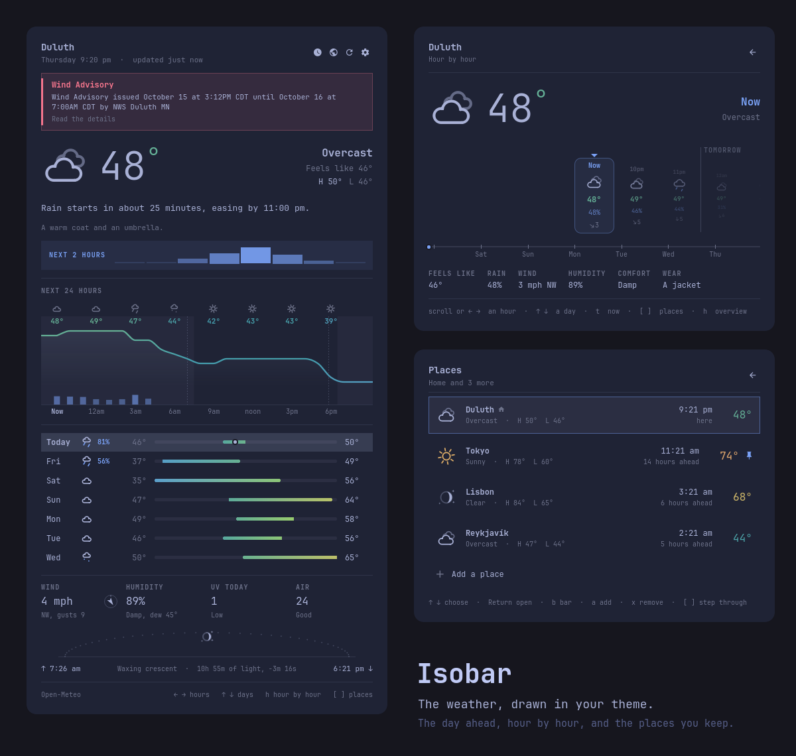

# Isobar

The weather, drawn in your theme.



A small sky on the bar beside the temperature. When rain is on its way, the bar says when ("Rain in 20m"), and on a dry day it says nothing. Click it for the day ahead: one sentence a person would say, the next 24 hours as one line, and the week as a row of thermometers.

## Features

- **A drawn sky.** The icons are drawn on a Canvas, not set in a font: sun, cloud, fog, drizzle, rain, sleet, snow and storms. Each is a single clean stroke at the bar's 14px and the panel's 72px. At night it draws the moon in its actual phase, with a few stars.
- **Weather that moves, briefly.** Rays turn, rain falls, snow sways, fog drifts and lightning flickers twice, but only while you hover or the panel is open. When the sky changes, the icon pops in. A still bar stays still.
- **A forecast in a sentence.** "Drizzle until about 8 pm. 3° cooler than yesterday." It says how long the current sky lasts and what comes after, compares today with yesterday, and mentions gusts or a high UV index when they matter.
- **The next two hours.** When something is falling, a strip of fifteen-minute bars shows how hard and for how long.
- **Twenty-four hours as one line.** A smooth curve that passes through every hour and never invents a peak between them. It's coloured along its length by temperature, with night as a faint band behind it, sunrise and sunset as dotted hairlines, and the chance of rain as bars beneath. Hover over it, or use `←` `→`, to read any hour.
- **The week as thermometers.** Each day's low and high sit on the week's shared scale, so a cold snap looks like one. Today's bar shows where the temperature is right now. Pick a day (`↑` `↓`, `1`–`7`, or a click) to put its hours on the chart.
- **The small facts.** A wind compass that points where the wind is going, humidity with the dew point, UV, air quality (or the pressure trend), and the sun's arc across today. It also shows how much daylight you gained or lost since yesterday, which tells you which way the year is turning.
- **In your theme.** Every colour comes from the current Omarchy theme's `colors.toml`: a yellow sun, blue rain, and a thermometer that runs from the theme's magenta through blue, cyan and green to its red. Change the theme and the panel changes with it.
- **Never blank.** The last good forecast is cached on disk, so the bar has a temperature the moment the shell starts. If the network drops, the panel keeps the last forecast, says how old it is, and retries with backoff (30s, 1m, 2m … up to 10m). After the machine wakes from sleep it fetches a fresh forecast within a minute.
- **Places.** Keep up to eight other cities beside home. The Places page shows each one's sky, temperature and local time, and how far ahead or behind you it is ("14 hours ahead"). Open one to see the full forecast there: its sentence, its hours, its week, its sun. A line underneath compares it with home ("6° warmer than Duluth · 14 hours ahead"). From the forecast, `[` and `]` step from place to place.
- **A heads-up, if you want one.** An optional quiet toast about half an hour before rain or snow, once per spell.

## Install

```bash
omarchy plugin add https://github.com/atsokolas/omarchy-isobar-plugin.git --enable
```

Move it if it didn't land where you want it:

```bash
omarchy bar move atsokolas.isobar --section center --after omarchy.clock
```

Isobar replaces the stock weather widget. To take that one off the bar, delete the `{ "id": "omarchy.weather" }` entry from `bar.layout` in `~/.config/omarchy/shell.json`. The bar reloads on save.

## Location

Isobar reads and writes `~/.local/state/omarchy/settings/weather.json`, the same file Omarchy's own weather widget and `omarchy-weather-location` use, so a location set in any of them applies to all three. Without one, it finds you from your network address.

In the panel, press `/` or click the place name, then search for a city. "Use my location" goes back to automatic.

## Places

Press `p` (or click the globe) for Places, then `a` to add a city. Places are stored in the widget's `shell.json` entry, so they move with the rest of your config.

To keep one in view, press `b` on its row (or click the pin). It joins the bar after home, as its name, its sky and its temperature, and clicking it opens straight to that place's forecast. Three fit on the bar; vertical bars keep to home.

```json
{
  "id": "atsokolas.isobar",
  "places": [
    { "name": "Tokyo", "description": "Tokyo, Japan", "latitude": 35.6895, "longitude": 139.6917, "onBar": true }
  ]
}
```

## Keys

| Key | Action |
| --- | --- |
| `←` `→` | Read the hours on the chart |
| `↑` `↓`, `1`–`7` | Pick a day |
| `t` | Back to now |
| `p` | Places |
| `[` `]` | Previous / next place |
| `g` | Back home |
| `/` | Change your location |
| `u` | Switch between °C and °F |
| `o` / `Return` | Open the radar at windy.com |
| `c` | Copy the forecast |
| `r` | Refresh |
| `s` | Settings |

On the Places page: `↑` `↓` choose, `Return` opens, `b` puts it on the bar or takes it off, `a` adds, `x` removes.

On the bar: left click opens the panel, middle click refreshes, and right click copies the forecast. A place on the bar opens to its own forecast.

## Settings

Change these on the widget's `shell.json` entry or on the panel's settings page.

| Key | Default | What it does |
|---|---|---|
| `unit` | `auto` | `auto` follows your locale (°F and mph in the US), or set `metric` or `imperial` |
| `showHint` | `true` | "Rain in 20m" beside the temperature, only when it's coming |
| `notify` | `false` | A quiet toast about half an hour before rain or snow |
| `animate` | `true` | The moving sky on hover and in the panel |
| `refreshMinutes` | `15` | How often to fetch, 5–180 |
| `places` | `[]` | Other cities to keep an eye on, up to eight |

## IPC

```bash
omarchy-shell atsokolas.isobar toggle
omarchy-shell atsokolas.isobar now        # 56° Light rain
omarchy-shell atsokolas.isobar summary    # Rain until about 8 pm. 3° cooler than yesterday.
omarchy-shell atsokolas.isobar place
omarchy-shell atsokolas.isobar places     # Tokyo  62°  Mostly clear  7:25 am
omarchy-shell atsokolas.isobar refresh
```

## Data

The forecast, nowcast and air quality come from [Open-Meteo](https://open-meteo.com), which is free and needs no key. Your location comes from your network address via `ipinfo.io`, but only when you haven't set one. Nothing else leaves the machine. Isobar writes only its own cache under `~/.cache/omarchy/isobar/`, the shared location file when you change location, and its own `shell.json` entry when you change a setting.

## Requirements

- Omarchy Quattro (Quickshell plugin support)
- `curl`
- `wl-copy` to copy the forecast

## Tests

The logic lives in `Model.js` as plain functions, so the QML stays thin. The tests run against a real Open-Meteo response, plus synthetic forecasts for the edge cases.

```bash
./tests/run
```

## Remove

```bash
omarchy plugin disable atsokolas.isobar
omarchy plugin remove atsokolas.isobar --yes
```

## License

MIT.
